# Einrichtung: IO-Darts in Home Assistant

Diese Anleitung verbindet ein Autodarts-Board in vier Schritten mit Home Assistant: Hub-Modul
`homeassistant` am IO-Darts-Agent-Hub installieren, Integration `io_darts` in Home Assistant über
HACS installieren, Integration hinzufügen und die Geräteseite prüfen. Danach zeigt sie, wie du das
Board in Automationen nutzt und die üblichen Probleme behebst.

[English version](../en/setup.md) · [README](../../README.md)

Die Screenshots stammen aus einer Demo-Umgebung, in der Hub und Home Assistant auf demselben Rechner
laufen. Deshalb steht in den Bildern `127.0.0.1`. In deinem Netzwerk verwendest du die LAN-Adresse
des Board-PCs (zum Beispiel `http://192.168.1.50:3000`) und die von Home Assistant.

## 1. Voraussetzungen

- **IO-Darts-Agent-Hub** läuft auf dem Board-PC, seine Weboberfläche ist erreichbar, standardmäßig
  auf Port 3000.
- **Home Assistant** mit installiertem **[HACS](https://hacs.xyz/)**.
- **Home Assistant ist vom Board-PC aus erreichbar**: Das Hub-Modul schickt die Match-Ereignisse an
  einen Webhook unter der internen URL von Home Assistant. Prüfe sie unter Einstellungen → System →
  Netzwerk → Home-Assistant-URL → Lokales Netzwerk. Wählt "Automatisch" eine Adresse, die der
  Board-PC nicht erreicht (zum Beispiel eine Docker-interne IP), schalte "Automatisch" aus, trage die
  LAN-Adresse von Home Assistant ein, z. B. `http://192.168.1.20:8123`, und klicke auf Speichern.
- **Hub-Anmeldung**: Ist am Hub die Web-Anmeldung aktiv, halte Benutzername und Passwort bereit.

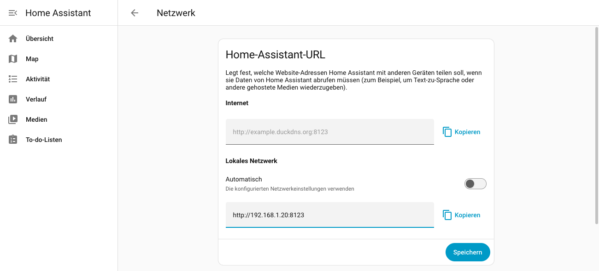

## 2. Hub-Modul installieren

1. Öffne die Weboberfläche des Hubs und melde dich an.
2. Gehe zu **Module** und klicke auf **Store**.
3. Klicke auf der Karte **Home Assistant** auf **Installieren**. Der Hub lädt das Modul von GitHub,
   das dauert einige Sekunden. Danach zeigt die Karte "Installiert".

   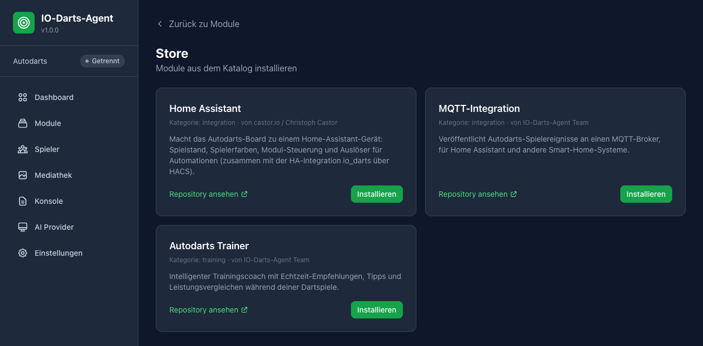

4. Wechsle zurück zu **Module**. Das Modul steht auf "Gestoppt": Klicke auf **Starten**. Der Status
   wechselt auf **Läuft**.

   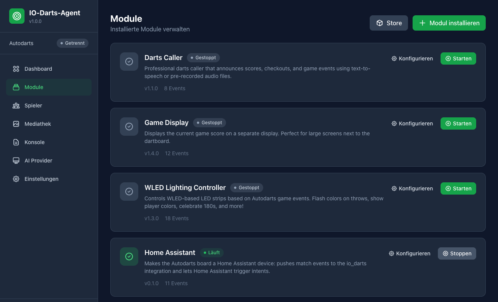

5. Empfohlen: Klicke beim Modul auf **Konfigurieren** und schalte **Autostart** ein, damit das Modul
   nach einem Neustart des Hubs wieder startet (der Hub startet Module, sobald er mit Autodarts
   verbunden ist). **Allowed Home Assistant hosts** kann leer bleiben. Trage nur dann Hostnamen oder
   IPs ein, wenn du einschränken willst, wohin der Webhook zeigen darf. Wenn du das Feld ausfüllst,
   muss dein Home-Assistant-Host darin stehen.

   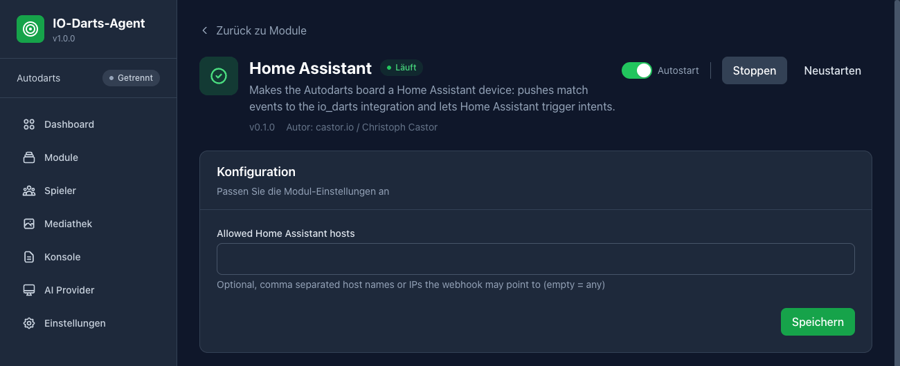

### Alternative: aus Git installieren

Zeigt der Store das Modul noch nicht an (oder hat der Hub keinen Store), installierst du es direkt
aus dem Repository:

1. **Module** → **Modul installieren** → **Git Repository**.
2. **Repository URL**: `https://github.com/Castorio/autodarts-home-assistant-module`, **Branch**
   leer lassen (dann gilt `main`).
3. Klicke auf **Modul installieren** und starte das Modul danach wie in Schritt 4 oben.

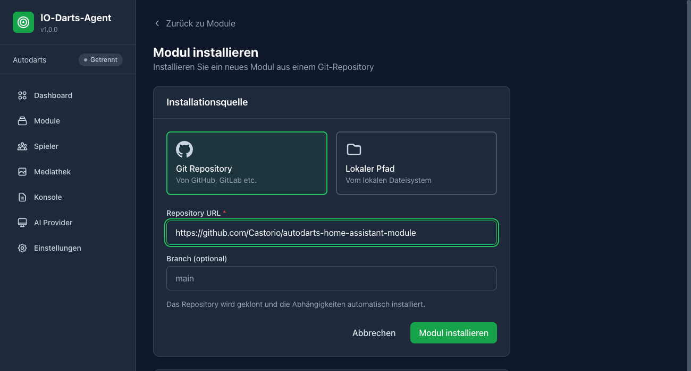

## 3. Integration über HACS installieren

Zu diesem Schritt gibt es keine Screenshots: HACS braucht eine GitHub-Anmeldung und ließ sich in der
Offline-Demo nicht einrichten.

1. Öffne in Home Assistant **HACS**.
2. Drei-Punkte-Menü (oben rechts) → **Benutzerdefinierte Repositories**.
3. **Repository**: `https://github.com/Castorio/autodarts-home-assistant-module`, **Typ**:
   **Integration** → **Hinzufügen**.
4. Suche in HACS nach **IO-Darts**, öffne den Eintrag und klicke auf **Herunterladen**.
5. Starte Home Assistant neu (Einstellungen → System → Drei-Punkte-Menü → Home Assistant neu
   starten).

## 4. Integration hinzufügen

1. **Einstellungen** → **Geräte & Dienste** → **Integration hinzufügen**.
2. Suche nach **IO-Darts** und wähle den Eintrag aus.

   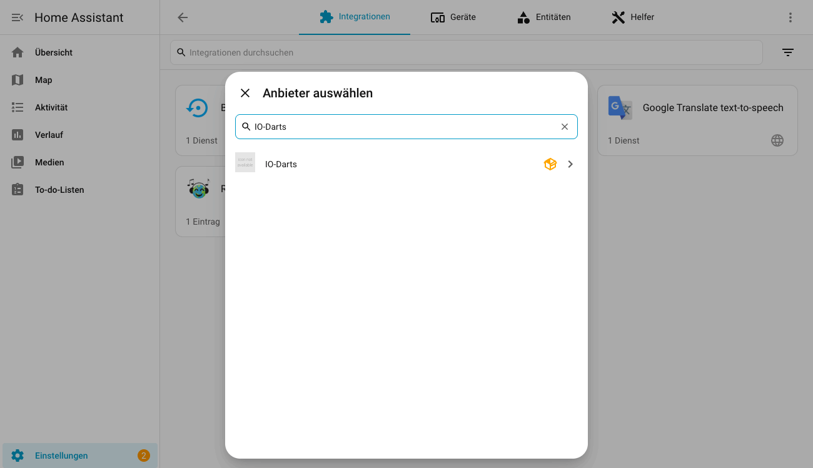

3. Das Formular **IO-Darts-Hub** öffnet sich:
   - **Hub-URL**: Adresse der Hub-Weboberfläche, z. B. `http://192.168.1.50:3000`.
   - **Benutzername** und **Passwort**: nur, wenn am Hub die Web-Anmeldung aktiv ist, sonst leer
     lassen.

   Klicke auf **OK**. Die Integration meldet sich an, prüft, ob das Hub-Modul `homeassistant` läuft,
   und registriert ihren Webhook beim Hub.

   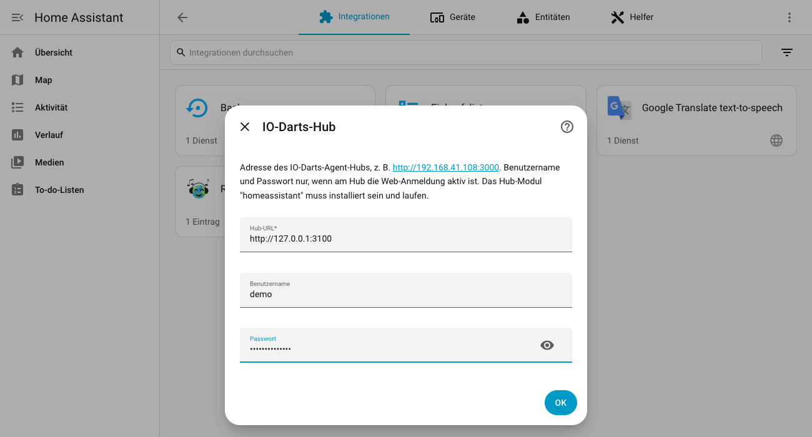

4. Der Dialog **Benennen und zuordnen** bestätigt das neue Gerät **IO-Darts Board**. Wähle bei
   Bedarf einen **Bereich** (geht auch später) und schließe den Dialog mit **Überspringen und
   fertigstellen**.

   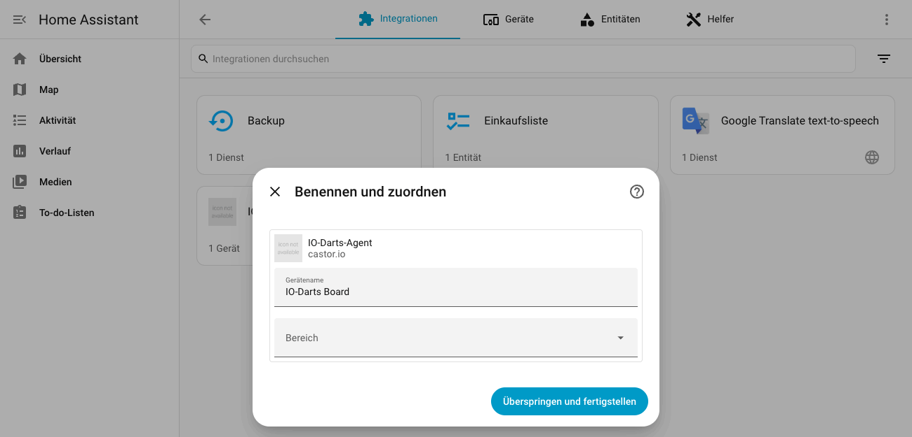

## 5. Die Geräteseite

Home Assistant öffnet die Geräteseite von **IO-Darts Board** (später: Einstellungen → Geräte &
Dienste → Geräte → IO-Darts Board). Während eines Matches aktualisieren sich die Werte live. Das Bild
zeigt ein laufendes Match zwischen Alice (rot) und Bob (blau): Alice ist am Zug, die aktuelle
Spielerfarbe ist `#ef4444`, die nächste `#3b82f6`.

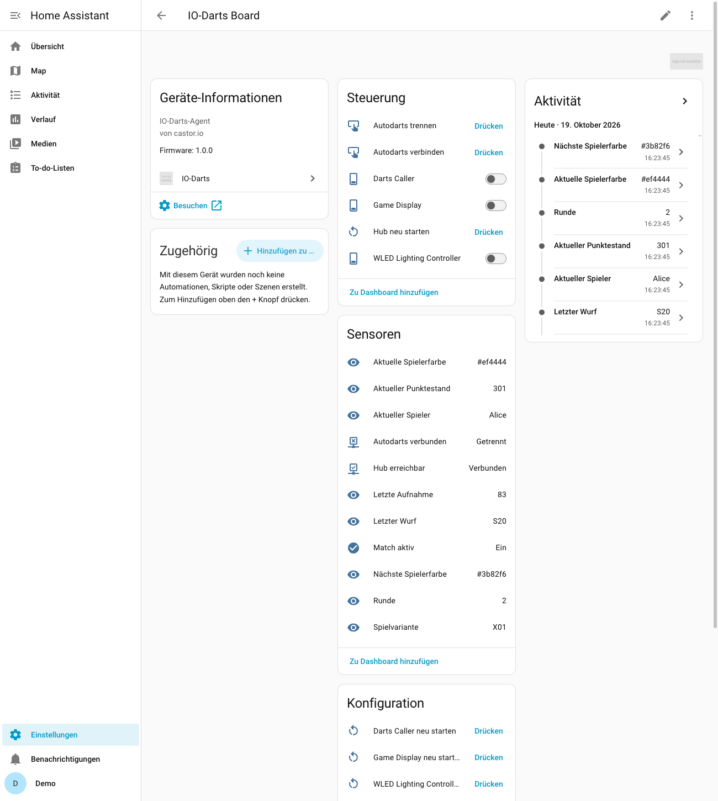

- **Steuerung**: Tasten **Autodarts verbinden**, **Autodarts trennen** und **Hub neu starten**,
  dazu ein Schalter pro Hub-Modul (z. B. Darts Caller, Game Display, WLED Lighting Controller), der
  anzeigt, ob das Modul läuft, und es startet oder stoppt.
- **Sensoren**: Aktueller Spieler, Aktueller Punktestand, Letzter Wurf, Letzte Aufnahme,
  Spielvariante, Runde, **Aktuelle Spielerfarbe** und **Nächste Spielerfarbe** (Hex-Wert, Attribut
  `rgb_color` für `light.turn_on`) sowie die Binärsensoren Match aktiv, Autodarts verbunden und Hub
  erreichbar.
- **Konfiguration**: eine Taste **`<Modul>` neu starten** pro Hub-Modul.
- **Diagnose** (weiter unten): Hub-Version, Hub gestartet, Laufende Module.

Alle Entitäten und ihre Attribute stehen in der README unter
[Entities](../../README.md#entities).

## 6. Nutzung

### Geräte-Auslöser im Automationseditor

1. **Einstellungen** → **Automationen & Szenen** → **Automation erstellen** → **Neue Automation
   erstellen**.
2. **Auslöser hinzufügen** → Reiter **Nach Typ** → **Gerät** (unter "Generisch").
3. **Gerät**: **IO-Darts Board**. **Auslöser**: z. B. **180 geworfen**.

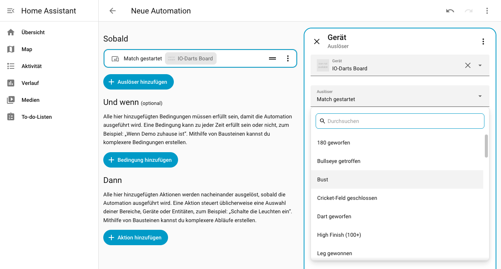

Verfügbare Auslöser: Match gestartet, Match gewonnen, Leg gewonnen, Spielerwechsel, Dart geworfen,
180 geworfen, Bust, Bullseye getroffen, Triple getroffen, High Finish (100+), Cricket-Feld
geschlossen. In derselben Liste stehen auch die allgemeinen Entitäts-Auslöser des Geräts (Taste
gedrückt, Schalter ein oder aus).

In YAML sieht der Auslöser so aus (die Geräte-ID setzt der Editor ein):

```yaml
triggers:
  - trigger: device
    domain: io_darts
    device_id: <io_darts_board_device_id>
    type: throw_180
```

Für Daten aus dem Match, z. B. den Spielernamen, nutzt du das Ereignis `io_darts_event` (siehe
[Event](../../README.md#event-io_darts_event)).

### Raumlicht in der Spielerfarbe

Die README enthält eine vollständige, erprobte Automation, die eine Lichtgruppe in der Farbe des
Spielers einfärbt, der am Zug ist, und nach dem Match jede Lampe wiederherstellt:
[Room lights follow the player color and are restored after the match](../../README.md#room-lights-follow-the-player-color-and-are-restored-after-the-match).
Beachte dort die deutschen Entitäts-IDs (siehe [unten](#entitäts-ids-hängen-von-der-sprache-ab)).

### Hub-Intent aus Home Assistant auslösen

Die Aktion **IO-Darts: Intent auslösen** (`io_darts.trigger_intent`) sendet am Hub den Intent
`homeassistant.trigger_<slot>` mit Slot 1 bis 5. Im Automationseditor: **Aktion hinzufügen** →
nach **IO-Darts** suchen → **IO-Darts: Intent auslösen** → **Slot** eintragen. In YAML:

```yaml
actions:
  - action: io_darts.trigger_intent
    data:
      slot: 1
```

Öffne am Hub das Modul, das reagieren soll (z. B. WLED oder Darts Caller), und ordne in seinen
Intent-Abonnements `homeassistant.trigger_1` einer Aktion zu.

## 7. Fehlerbehebung

### "Das Hub-Modul "homeassistant" ist nicht installiert oder läuft nicht."

Das Formular zeigt diesen Fehler, oder später erscheint unter Einstellungen → System → Reparaturen
der Eintrag **IO-Darts-Hub-Modul fehlt**. Installiere oder starte das Modul in der Hub-Oberfläche
(Schritt 2). Etwa 30 Sekunden, nachdem das Modul wieder läuft, verschwindet die Reparatur von
selbst, und die Match-Daten kommen ohne weiteres Zutun wieder an. Schalte **Autostart** ein, damit
das nicht nach jedem Neustart des Hubs passiert.

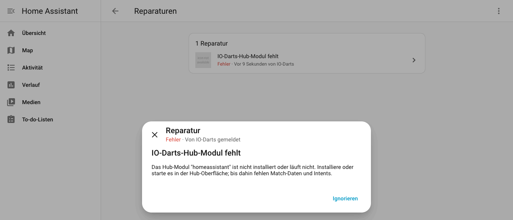

### "Der Hub ist nicht erreichbar."

- Prüfe die **Hub-URL**: `http://`, die IP des Board-PCs und den Port (Standard `3000`).
- Öffne dieselbe URL im Browser auf dem Home-Assistant-Rechner oder auf einem anderen Gerät im
  selben Netzwerk.
- Firewall am Board-PC: Der Hub-Port muss von Home Assistant aus erreichbar sein.

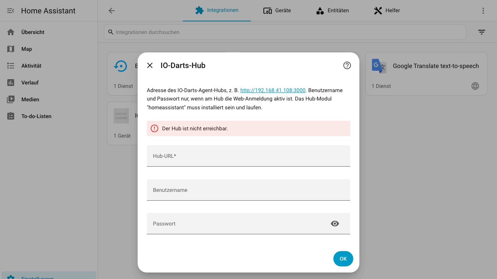

### "Benutzername oder Passwort ist falsch."

Gemeint ist die Web-Anmeldung des Hubs (die für die Hub-Oberfläche), nicht dein Autodarts-Konto.

### Home Assistant has no internal URL the hub can reach

Die Integration lässt sich nicht einrichten und zeigt diese Meldung (Home Assistant versucht es
automatisch erneut), oder das Gerät zeigt keine Match-Werte, obwohl das Modul läuft. Stelle die interne URL ein wie unter
[Voraussetzungen](#1-voraussetzungen) beschrieben. Der Webhook ist nur lokal erreichbar: Pushes, die
über den Fernzugriff (z. B. Nabu Casa) kommen, lehnt Home Assistant absichtlich ab.

### Passwort am Hub geändert

Lehnt der Hub die gespeicherte Anmeldung ab, zeigt Home Assistant unter Einstellungen → Geräte &
Dienste den Eintrag **IO-Darts Board** mit der Schaltfläche **Neu konfigurieren**. Klicke darauf,
gib **Benutzername** und **Passwort** erneut ein (beide Felder sind leer) und bestätige mit **OK**.

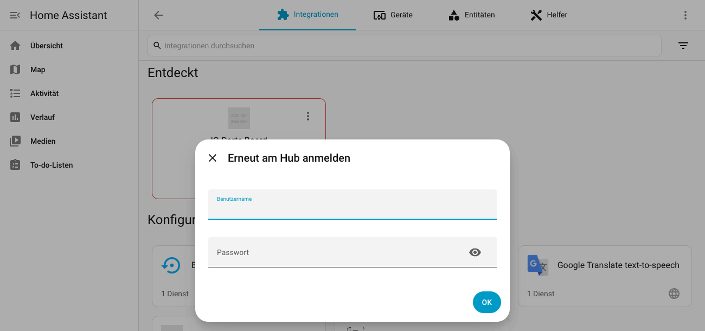

### Entitäts-IDs hängen von der Sprache ab

Die Entitäts-IDs entstehen aus den Entitätsnamen in der Sprache, die Home Assistant beim Hinzufügen
der Integration hatte. Deutsch: `sensor.io_darts_board_aktuelle_spielerfarbe`,
`binary_sensor.io_darts_board_match_aktiv`. Englisch:
`sensor.io_darts_board_current_player_color`, `binary_sensor.io_darts_board_match_active`. Die
YAML-Beispiele in der README verwenden die englischen IDs. Übernimm die IDs von der Geräteseite
(Entität anklicken → Einstellungen), bevor du sie einsetzt.
