# Setup guide: IO-Darts in Home Assistant

This guide connects an Autodarts board to Home Assistant in four steps: install the hub module
`homeassistant` on the IO-Darts-Agent hub, install the `io_darts` integration in Home Assistant via
HACS, add the integration and check the device page. After that it shows how to use the board in
automations and how to fix the usual problems.

[Deutsche Version](../de/setup.md) · [README](../../README.md)

The screenshots come from a demo setup: hub and Home Assistant run on the same machine there, so
the addresses in the pictures are `127.0.0.1`. In your network use the LAN address of the board PC
(for example `http://192.168.1.50:3000`) and of Home Assistant.

## 1. Requirements

- **IO-Darts-Agent hub** is running on the board PC and its web UI is reachable, by default on
  port 3000.
- **Home Assistant** with **[HACS](https://hacs.xyz/)** installed.
- **Home Assistant is reachable from the board PC**: the hub module pushes match events to a
  webhook on Home Assistant's internal URL. Check it under Settings → System → Network →
  Home Assistant URL → Local network. If "Automatic" picks an address the board PC cannot reach
  (for example a Docker internal IP), switch "Automatic" off, enter the LAN address of Home
  Assistant, e.g. `http://192.168.1.20:8123`, and click Save.
- **Hub login**: if web login is enabled on the hub, have its username and password ready.

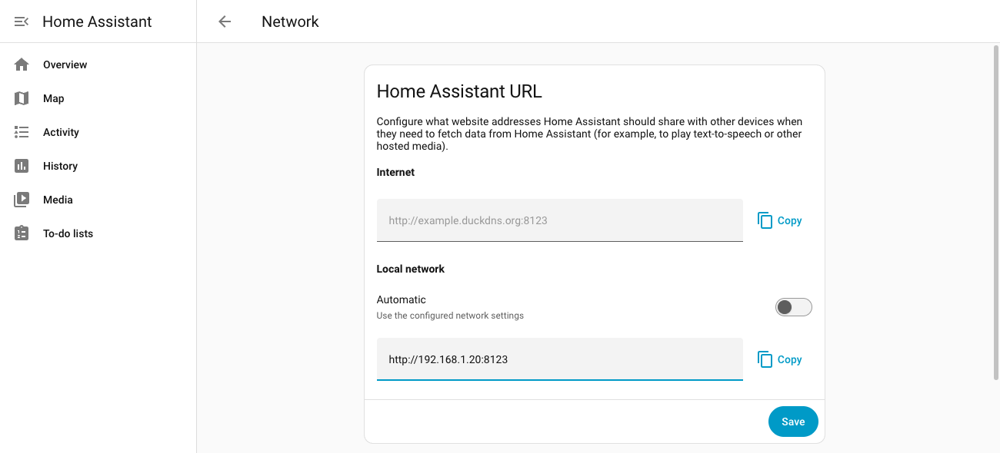

## 2. Install the hub module

1. Open the hub web UI and log in.
2. Go to **Modules** and click **Store**.
3. On the **Home Assistant** card click **Install**. The hub clones the module from GitHub, which
   takes a few seconds; the card then shows "Installed".

   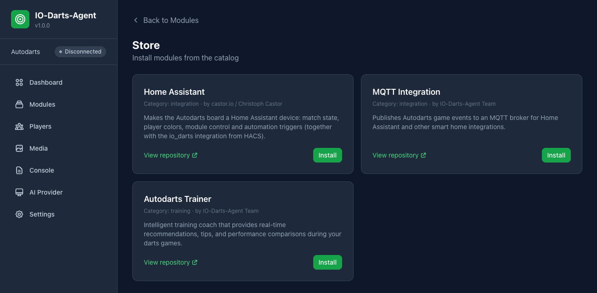

4. Go back to **Modules**. The module is listed as "Stopped": click **Start**. The status changes
   to **Running**.

   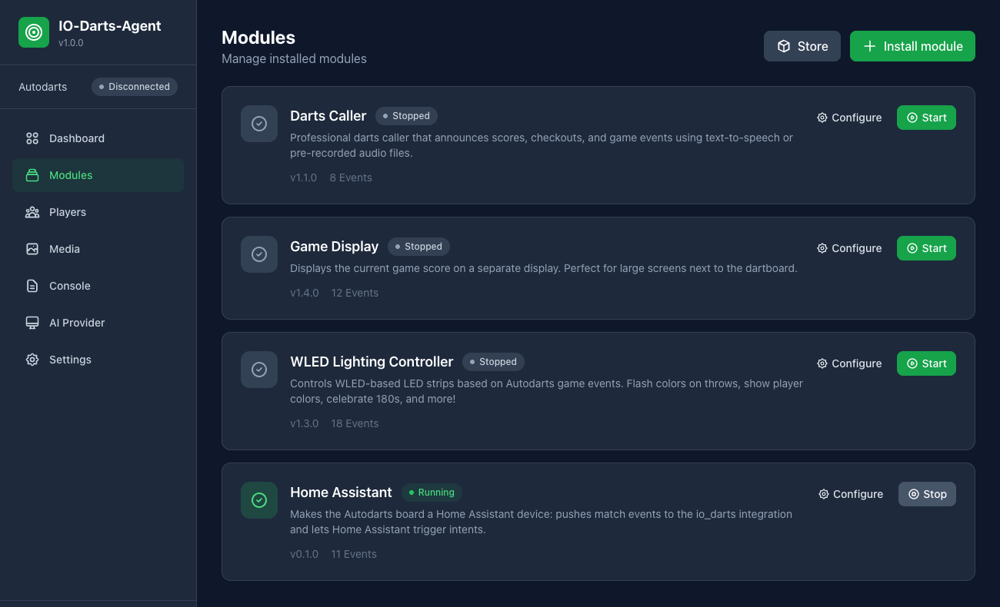

5. Recommended: click **Configure** on the module and switch on **Autostart**, so the module starts
   again after a hub restart (the hub starts modules once it is connected to Autodarts).
   **Allowed Home Assistant hosts** can stay empty; enter host names or IPs only if you want to
   restrict which host the webhook may point to. If you fill it in, it must contain your Home
   Assistant host.

   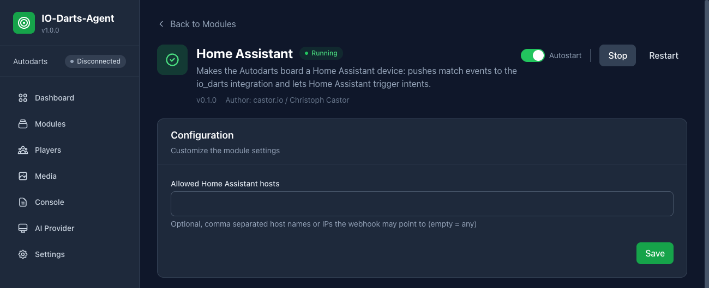

### Fallback: install from Git

If the store does not list the module yet (or the hub has no store), install it directly from the
repository:

1. **Modules** → **Install module** → **Git Repository**.
2. **Repository URL**: `https://github.com/Castorio/autodarts-home-assistant-module`, leave
   **Branch** empty (uses `main`).
3. Click **Install Module**, then start the module as in step 4 above.

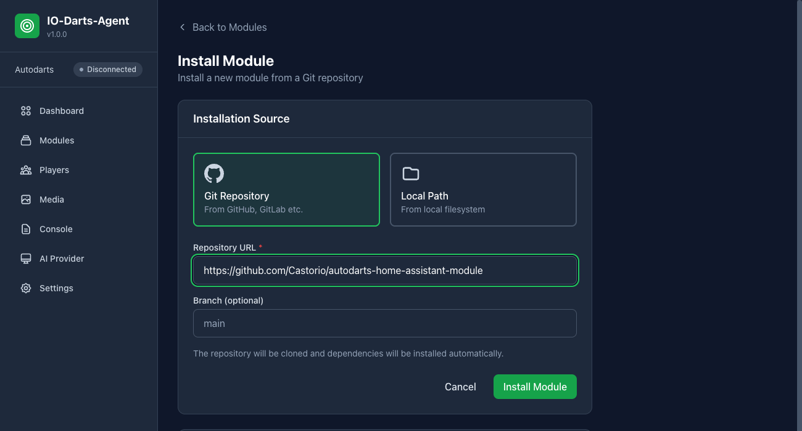

## 3. Install the integration via HACS

No screenshots for this step: HACS needs a GitHub login and could not be set up in the offline demo.

1. In Home Assistant open **HACS**.
2. Three-dot menu (top right) → **Custom repositories**.
3. **Repository**: `https://github.com/Castorio/autodarts-home-assistant-module`, **Type**:
   **Integration** → **Add**.
4. Search HACS for **IO-Darts**, open it and click **Download**.
5. Restart Home Assistant (Settings → System → three-dot menu → Restart Home Assistant).

## 4. Add the integration

1. **Settings** → **Devices & services** → **Add integration**.
2. Search for **IO-Darts** and select it.

   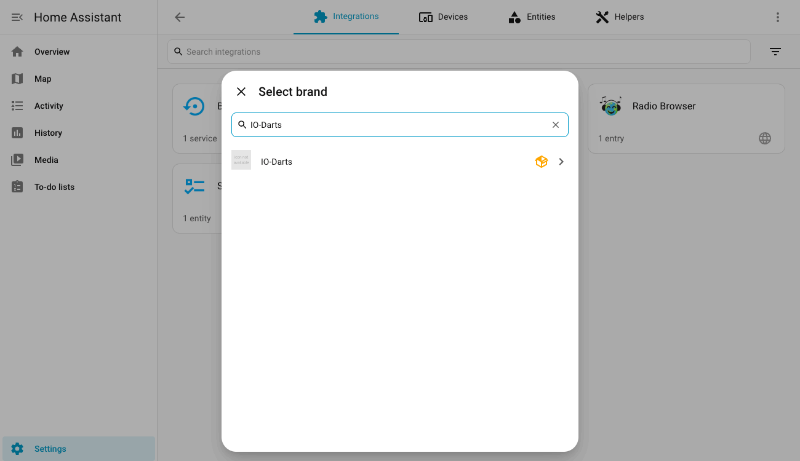

3. The form **IO-Darts hub** opens:
   - **Hub URL**: address of the hub web UI, e.g. `http://192.168.1.50:3000`.
   - **Username** and **Password**: only if web login is enabled on the hub, otherwise leave them
     empty.

   Click **Submit**. The integration logs in, checks that the hub module `homeassistant` is running
   and registers its webhook with the hub.

   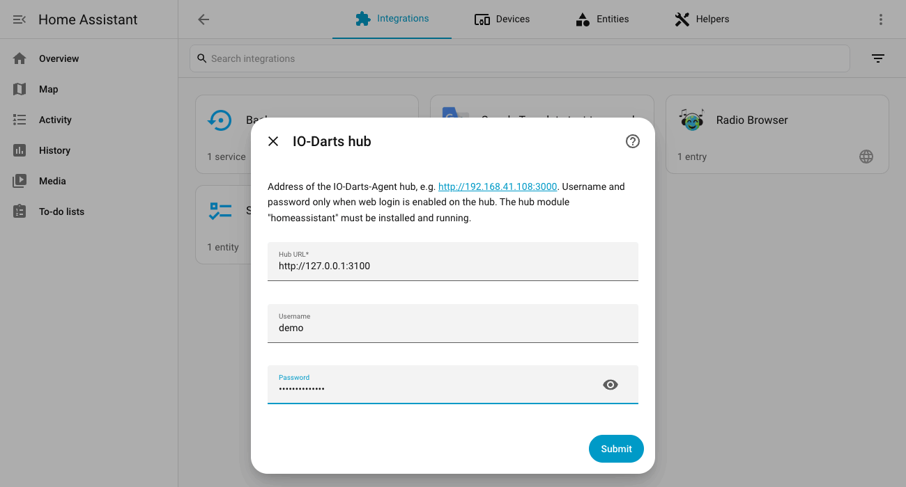

4. The dialog **Name and assign** confirms the new device **IO-Darts Board**. Optionally pick an
   **Area** (it can also be set later), then close the dialog with **Skip and finish**.

   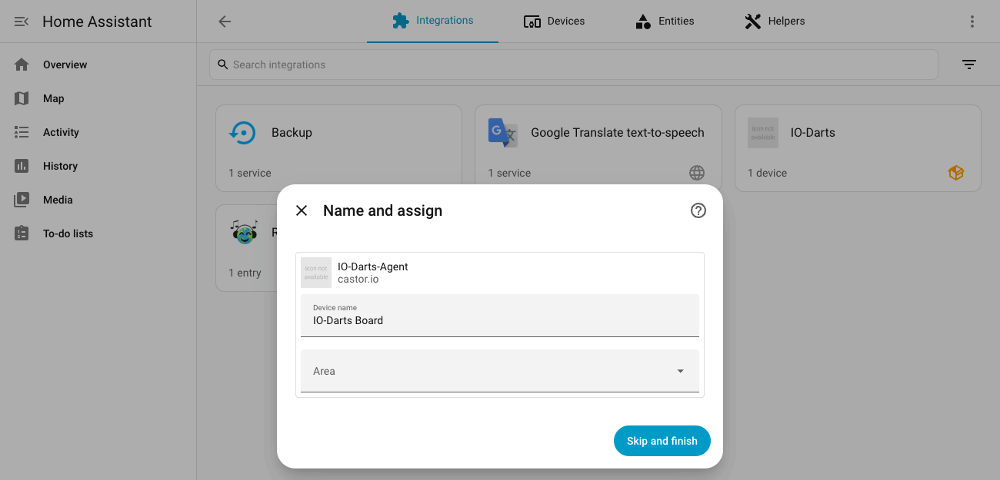

## 5. The device page

Home Assistant opens the device page of **IO-Darts Board** (later: Settings → Devices & services →
Devices → IO-Darts Board). During a match the values update live. The picture shows a running
match between Alice (red) and Bob (blue): it is Alice's turn, the current player color is
`#ef4444`, the next one `#3b82f6`.

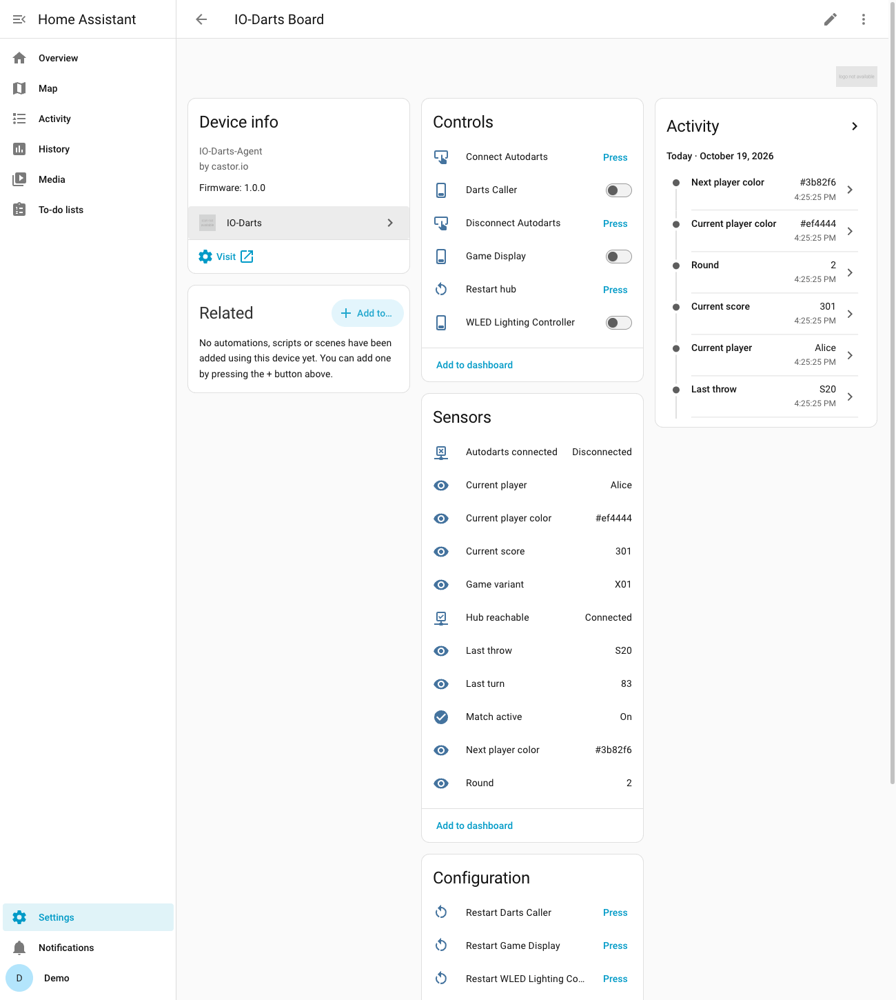

- **Controls**: buttons **Connect Autodarts**, **Disconnect Autodarts** and **Restart hub**, plus
  one switch per hub module (e.g. Darts Caller, Game Display, WLED Lighting Controller) that shows
  whether the module runs and starts or stops it.
- **Sensors**: Current player, Current score, Last throw, Last turn, Game variant, Round,
  **Current player color** and **Next player color** (hex value, attribute `rgb_color` for
  `light.turn_on`), and the binary sensors Match active, Autodarts connected and Hub reachable.
- **Configuration**: one **Restart `<module>`** button per hub module.
- **Diagnostic** (further down): Hub version, Hub started, Running modules.

All entities and their attributes are listed in the README under
[Entities](../../README.md#entities).

## 6. Using it

### Device triggers in the automation editor

1. **Settings** → **Automations & scenes** → **Create automation** → **Create new automation**.
2. **Add trigger** → tab **By type** → **Device** (under "Generic").
3. **Device**: **IO-Darts Board**. **Trigger**: e.g. **180 thrown**.

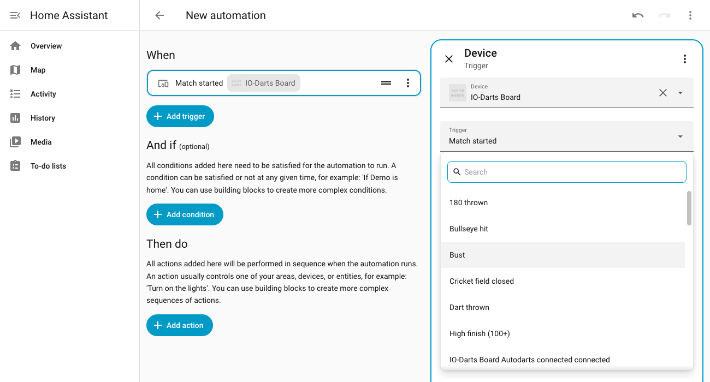

Available triggers: Match started, Match won, Leg won, Player changed, Dart thrown, 180 thrown,
Bust, Bullseye hit, Triple hit, High finish (100+), Cricket field closed. The same list also
contains the generic entity triggers of the device (buttons pressed, switches turned on or off).

In YAML the trigger looks like this (the device ID is filled in by the editor):

```yaml
triggers:
  - trigger: device
    domain: io_darts
    device_id: <io_darts_board_device_id>
    type: throw_180
```

For data from the match, e.g. the player name, use the event `io_darts_event` (see
[Event](../../README.md#event-io_darts_event)).

### Room lights in the player color

The README contains a complete, tested automation that colors a light group in the color of the
player whose turn it is and restores every lamp after the match:
[Room lights follow the player color and are restored after the match](../../README.md#room-lights-follow-the-player-color-and-are-restored-after-the-match).

### Trigger a hub intent from Home Assistant

The action **IO-Darts: Trigger intent** (`io_darts.trigger_intent`) emits the hub intent
`homeassistant.trigger_<slot>` with slot 1 to 5. In the automation editor: **Add action** → search
**IO-Darts** → **IO-Darts: Trigger intent** → enter the **Slot**. In YAML:

```yaml
actions:
  - action: io_darts.trigger_intent
    data:
      slot: 1
```

On the hub, open the module that should react (e.g. WLED or Darts Caller) and map
`homeassistant.trigger_1` to an action in its intent subscriptions.

## 7. Troubleshooting

### "The hub module "homeassistant" is not installed or not running."

The form shows this error, or later a repair **IO-Darts hub module missing** appears under
Settings → System → Repairs. Install or start the module in the hub UI (step 2). The repair
disappears by itself within about 30 seconds after the module runs again, and match data flows
again without further action. Switch on **Autostart** so this does not happen after every hub
restart.

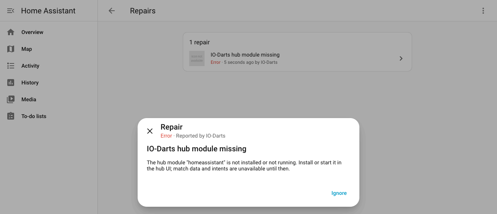

### "The hub cannot be reached."

- Check the **Hub URL**: `http://`, the IP of the board PC and the port (default `3000`).
- Open the same URL in a browser on the Home Assistant machine, or from another device in the
  same network.
- Firewall on the board PC: the hub port must be reachable from Home Assistant.

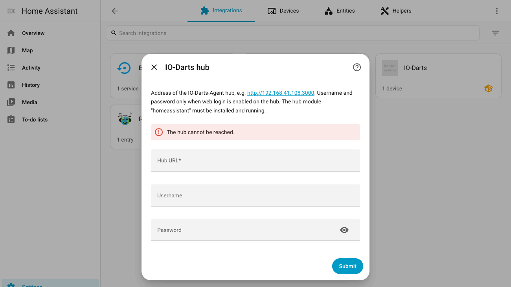

### "Username or password is wrong."

Use the hub web login (the one you use for the hub UI), not your Autodarts account.

### Home Assistant has no internal URL the hub can reach

The integration stays in "Failed to set up, will retry" with this message, or the device shows no
match values although the module runs. Set the internal URL as described under
[Requirements](#1-requirements). The webhook is local only: pushes that come through remote access
(e.g. Nabu Casa) are rejected on purpose.

### Password changed on the hub

When the hub rejects the stored login, Home Assistant shows **IO-Darts Board** under
Settings → Devices & services with a **Reconfigure** button. Click it, enter **Username** and
**Password** again (both fields start empty) and click **Submit**.

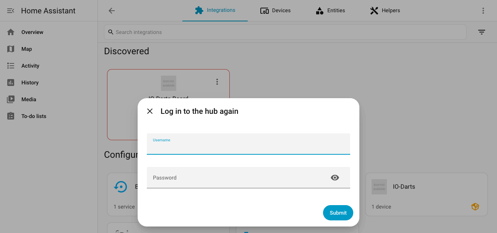

### Entity IDs depend on the Home Assistant language

Entity IDs are created from the entity names in the language Home Assistant had when the
integration was added. English: `sensor.io_darts_board_current_player_color`,
`binary_sensor.io_darts_board_match_active`. German:
`sensor.io_darts_board_aktuelle_spielerfarbe`, `binary_sensor.io_darts_board_match_aktiv`.
Copy the IDs from the device page (click an entity → settings) before you use the YAML examples.
